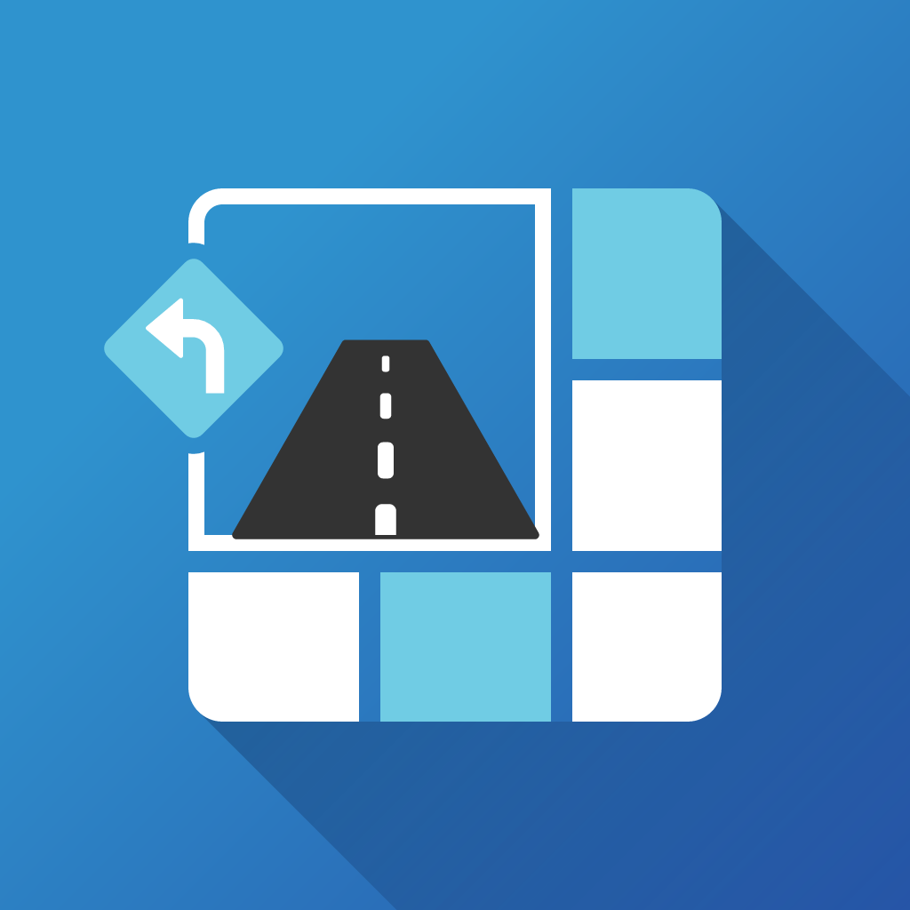
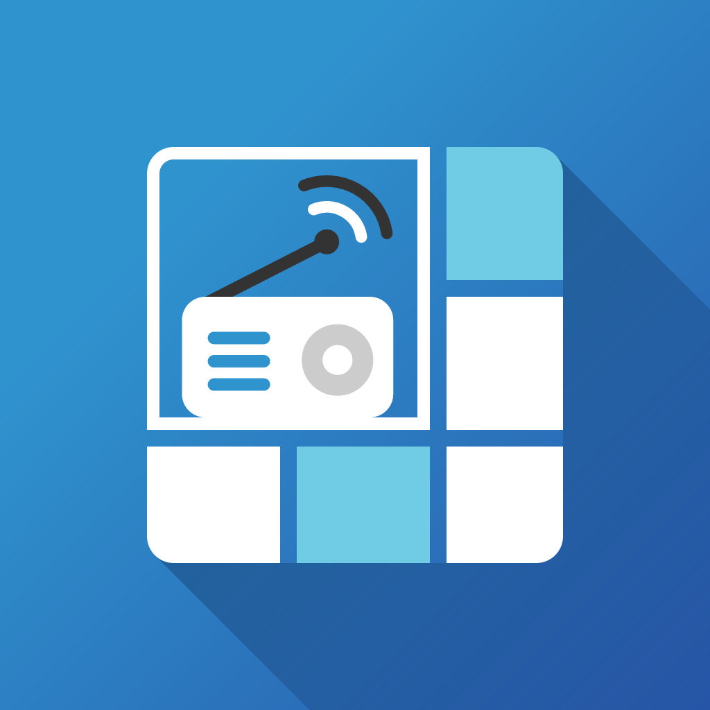

<div align='center'>

&nbsp;
&nbsp;
&nbsp;
&nbsp;


<h1>Resgrid Omni</h1>
<p><strong>The open-source mobile, web and desktop apps for <a href="https://resgrid.com">Resgrid</a></strong> — computer-aided dispatch (CAD), personnel, unit and incident management for fire departments, EMS, search and rescue, emergency management and any team that responds to events.</p>
<p>Five apps — Responder, Unit, IC, Dispatch and BigBoard — from one codebase, for iOS, Android, the web and Windows, macOS and Linux.</p>

[](LICENSE)


<h4><a href="https://resgrid.com">Website</a> <span> · </span> <a href="https://docs.resgrid.com">Documentation</a> <span> · </span> <a href="#sos-getting-help">Get Help</a> <span> · </span> <a href="https://github.com/Resgrid/Omni/issues/new?template=1-bug-report.yml">Report a Bug</a> <span> · </span> <a href="https://github.com/Resgrid/Omni/issues/new?template=2-feature-request.yml">Request a Feature</a></h4>

</div>

> [!NOTE]
> **Just want to use the apps?** You don't need anything from this repository. [Get the app](#iphone-the-apps) from your app store or open it in your browser, and sign in with your Resgrid account.
>
> **Project status:** the code for all five apps is complete and being verified on devices. Until an app's first Omni build is published, the version in the stores still comes from that app's original repository ([Responder](https://github.com/Resgrid/Responder), [Unit](https://github.com/Resgrid/Unit), [IC](https://github.com/Resgrid/IC), [Dispatch](https://github.com/Resgrid/Dispatch), [BigBoard](https://github.com/Resgrid/BigBoard)). Bugs and requests for every app are welcome here either way. Progress is tracked in [docs/implementation-status.md](docs/implementation-status.md).

# :notebook_with_decorative_cover: Table of Contents

- [What is Resgrid?](#star2-what-is-resgrid)
- [The Apps](#iphone-the-apps)
- [Using the Apps](#wave-using-the-apps)
- [Getting Help](#sos-getting-help)
- [Features](#dart-features)
- [Run It Yourself](#toolbox-run-it-yourself)
- [Self-Hosting and Deployment](#package-self-hosting-and-deployment)
- [How the Code Is Organized](#jigsaw-how-the-code-is-organized)
- [Contributing](#handshake-contributing)
- [Roadmap](#compass-roadmap)
- [FAQ](#grey_question-faq)
- [License](#warning-license)

## :star2: What is Resgrid?

[Resgrid](https://resgrid.com) is an open-source platform for organizations that respond to emergencies and events: volunteer and career fire departments, EMS agencies, search and rescue teams, CERT, emergency management offices, industrial and campus response teams, and more. It handles dispatching calls, alerting and messaging members, tracking who is available and where units are, running incidents, scheduling shifts and keeping records.

Resgrid has two halves:

- **[Resgrid Core](https://github.com/Resgrid/Core)** — the server, API and the resgrid.com web application. Use the hosted service or run it yourself.
- **Resgrid Omni (this repository)** — the client apps people carry, mount in vehicles, sit at, or put on the station wall. Every app talks to Resgrid Core.

## :iphone: The Apps

| | App | Who it's for | What it does | Get it |
|---|---|---|---|---|
|  | **Responder** | Department members | Get dispatched and respond, set your status and staffing, read call details, message and chat, manage shifts and trades, calendar, checklists, work orders and certifications | [App Store](https://apps.apple.com/us/app/resgrid-responder/id538861031) · [Google Play](https://play.google.com/store/apps/details?id=wtdt.resgrid.andriod) · [Web](https://responder.resgrid.com) |
|  | **Unit** | Apparatus, vehicle and team crews | A mobile data terminal (MDT) for vehicle tablets and laptops: unit status, crew roles, automatic vehicle location, push-to-talk, turn-by-turn navigation, routes and stops, inventory | [App Store](https://apps.apple.com/us/app/resgrid-unit/id854151893) · [Google Play](https://play.google.com/store/apps/details?id=com.resgrid.unit) · [Web](https://unit.resgrid.com) |
|  | **IC** | Incident commanders | A digital command board for tablets and desktops: ICS structure, resource tracking, accountability and PAR, objectives, timers and command maps | [Google Play](https://play.google.com/store/apps/details?id=com.resgrid.command) |
|  | **Dispatch** | Dispatchers | A multi-panel dispatch console: create and dispatch calls, pending, scheduled and archived call queues, run cards, unit and personnel actions, weather alerts | [Web](https://dispatch.resgrid.com) |
|  | **BigBoard** | Stations and EOCs | A wall-display dashboard: active calls, units with status timers, personnel, maps, weather and alerts, in a layout you configure | [Web](https://bigboard.resgrid.com) |

Every app is built for **iOS, Android, the web and desktop (Windows, macOS, Linux)**. Once an app moves to Omni, its desktop installers and a self-hostable Docker image are published with each [GitHub Release](https://github.com/Resgrid/Omni/releases).

## :wave: Using the Apps

1. **Get a Resgrid account.** Your department, agency or team signs up at [resgrid.com](https://resgrid.com), then adds its members, units and groups. If your organization already uses Resgrid, ask your administrator for an account.
2. **Install the app you need** from the table above, or open its web version.
3. **Sign in** with your Resgrid username and password, or with your organization's single sign-on.
4. **Using your own Resgrid server?** On the sign-in screen, choose **Change Server URL** and enter your server's address.

How-to guides for every part of Resgrid are in the [Resgrid documentation](https://docs.resgrid.com) and the [Resgrid Help Center](https://resgrid.zohodesk.com/portal/en/home).

## :sos: Getting Help

**First, find out which app and version you have.** The app's name is on its icon and in **Settings → About → App Name**; the same screen shows the **Version** with the build number in brackets, for example `Version 8.12 (100012)`. Include both whenever you ask for help.

| You need help with… | Go to |
|---|---|
| Every app stopped working or cannot connect | [Resgrid system status](https://resgrid.freshstatus.io) |
| Your account, billing, subscription or department setup | [Resgrid Help Center](https://resgrid.zohodesk.com/portal/en/home) or [contact Resgrid](https://resgrid.com/contact) |
| Something in an app is broken | [Report a bug](https://github.com/Resgrid/Omni/issues/new?template=1-bug-report.yml) |
| An idea for a new feature or a change | [Request a feature](https://github.com/Resgrid/Omni/issues/new?template=2-feature-request.yml) |
| How an app works, or building it from this repository | [Ask a question](https://github.com/Resgrid/Omni/issues/new?template=3-question.yml) |
| Telling us what works well or what is hard to use | [Share feedback](https://github.com/Resgrid/Omni/issues/new?template=4-feedback.yml) |
| Wrong or untranslated text | [Report a translation problem](https://github.com/Resgrid/Omni/issues/new?template=5-translation.yml) |
| The resgrid.com website or the API | [Resgrid Core issues](https://github.com/Resgrid/Core/issues) |
| A security vulnerability | The [security policy](.github/SECURITY.md) — **never a public issue** |

### Help with a specific app

Every issue form asks which app (and platform) the issue is about, and the issue is labelled automatically, so it reaches the people who work on that app. Before opening a new issue, check whether someone has already reported it — add a 👍 to an existing issue instead of a "+1" comment.

| App | Known issues | Usually runs on |
|---|---|---|
| Responder | [Open issues for Responder](https://github.com/Resgrid/Omni/issues?q=is%3Aissue%20state%3Aopen%20label%3A%22app%3A%20responder%22) | Phones |
| Unit | [Open issues for Unit](https://github.com/Resgrid/Omni/issues?q=is%3Aissue%20state%3Aopen%20label%3A%22app%3A%20unit%22) | Vehicle tablets and laptops (MDT) |
| IC | [Open issues for IC](https://github.com/Resgrid/Omni/issues?q=is%3Aissue%20state%3Aopen%20label%3A%22app%3A%20ic%22) | Tablets and desktops |
| Dispatch | [Open issues for Dispatch](https://github.com/Resgrid/Omni/issues?q=is%3Aissue%20state%3Aopen%20label%3A%22app%3A%20dispatch%22) | Desktops and the web |
| BigBoard | [Open issues for BigBoard](https://github.com/Resgrid/Omni/issues?q=is%3Aissue%20state%3Aopen%20label%3A%22app%3A%20bigboard%22) | Wall displays and TVs |
| All apps | [Issues affecting every app](https://github.com/Resgrid/Omni/issues?q=is%3Aissue%20state%3Aopen%20label%3A%22app%3A%20all%22) | |

You can narrow any search by platform too, for example `label:"platform: android"` or `label:"platform: ios"`.

> [!WARNING]
> Issues are public. Never include passwords, tokens, personal details of members, patients or callers, call addresses or notes, or anything your organization treats as protected. Blur them in screenshots.

Bugs seen when the apps connect to a **self-hosted** Resgrid Core server are welcome here (choose *Self-hosted Resgrid Core* in the bug form). Help installing or running your own server is not provided through GitHub — [contact Resgrid](https://resgrid.com/contact). More detail is in [SUPPORT.md](.github/SUPPORT.md).

## :dart: Features

Shared by all five apps:

- **Works offline** — the shift's working data is kept on the device. Actions taken without a connection are queued, survive restarts and are sent exactly once when the connection returns.
- **Offline maps** — MapLibre maps everywhere, with downloadable base maps and your department's own map data (custom and indoor maps, layers, POIs, hydrants) for its response area.
- **Live updates** — calls, statuses, units, personnel locations, incident command, chat and weather alerts update in real time.
- **Notifications** — push notifications on mobile, web and desktop, with critical alerts for dispatches and a notification inbox.
- **Push-to-talk voice** — with Bluetooth and headset PTT buttons where the app needs them.
- **Turn-by-turn navigation** — built into Unit, with live ETAs shown to dispatchers and on the BigBoard.
- **Secure sign-in** — multi-factor authentication, passkeys and single sign-on (OIDC/SAML), shared-device sessions for vehicles and consoles, protected data handling.
- **Fits your organization** — department terminology (rename calls, units, record types…), custom statuses, permissions and feature flags are honoured everywhere.
- **Ten languages** — English, Arabic, German, Greek, Spanish, French, Italian, Polish, Swedish and Ukrainian.
- **Quick fixes** — fixes ship as over-the-air updates without waiting for an app store review.

## :toolbox: Run It Yourself

You only need this section if you want to run the apps from source, change them or contribute.

### Prerequisites

- [Node.js](https://nodejs.org) 22.18 or newer and [pnpm](https://pnpm.io) 10.5 or newer (`corepack enable` gives you the version this repository pins)
- [Git](https://git-scm.com)
- For iOS: macOS with Xcode. For Android: Android Studio with JDK 17. Neither is needed for the web or desktop apps.
- A Resgrid account — on the hosted service or your own [Resgrid Core](https://github.com/Resgrid/Core) server

### Install

```bash
git clone https://github.com/Resgrid/Omni.git
cd Omni
corepack enable
pnpm install
```

### Pick an app

One project builds all five apps. The `APP_VARIANT` environment variable chooses which one: `responder`, `unit`, `ic`, `dispatch` or `bigboard`.

The quickest way to see an app is the web version — no Xcode or Android Studio needed. It opens at http://localhost:8081:

```bash
APP_VARIANT=dispatch pnpm --filter @resgrid/omni web
```

On iOS or Android (builds and installs a development build on a simulator, emulator or connected device):

```bash
APP_VARIANT=responder pnpm --filter @resgrid/omni ios
```

```bash
APP_VARIANT=unit pnpm --filter @resgrid/omni android
```

As a desktop app (start the web version first, then in a second terminal):

```bash
APP_VARIANT=bigboard pnpm --filter @resgrid/desktop dev
```

> [!TIP]
> - **Windows PowerShell:** set the variable first, for example `$env:APP_VARIANT = "unit"`, then run the command without the `APP_VARIANT=…` prefix.
> - **Expo Go is not supported** — the apps use native modules, so run them with the commands above.
> - **Switched apps and still see the old one?** Stop the dev server and start it again with `--clear`.

### Choose a server

Development builds connect to Resgrid's QA server by default. To sign in with your account on the hosted service or on your own server, set `BASE_API_URL` before starting the app, or use **Change Server URL** on the sign-in screen:

```bash
BASE_API_URL=https://api.resgrid.com APP_VARIANT=unit pnpm --filter @resgrid/omni web
```

`.env` files are not read; set variables in your shell. The full list of settings (API paths, hub names, Sentry, Countly) is in [docker/README.md](docker/README.md#runtime-configuration) — each one also works as an environment variable at development time.

Push notifications on iOS and Android need the app's Firebase files (`google-services.json`, `GoogleService-Info.plist`), which are not in this repository. Without them the apps still build and run; they just don't receive push.

### Run the checks

```bash
pnpm test          # Jest unit and component tests
pnpm lint          # ESLint (zero warnings)
pnpm type-check    # TypeScript
pnpm i18n:check    # translation keys match across all ten languages
pnpm check-all     # everything CI checks except tests
pnpm e2e:web       # Playwright tests against the web builds
```

## :package: Self-Hosting and Deployment

#### 🐳 Web app in Docker
Each app has a multi-architecture (amd64, arm64) image — `resgridllc/responder`, `resgridllc/unit`, `resgridllc/ic`, `resgridllc/dispatch`, `resgridllc/bigboard` — configured with environment variables when the container starts:

```bash
docker run -d -p 8080:80 -e BASE_API_URL="https://api.example.com" resgridllc/unit:latest
```

The variable names used by the original images (such as `UNIT_BASE_API_URL`) keep working. Every setting, Docker Compose, health checks and passkey/app-link files: [docker/README.md](docker/README.md).

#### 🌐 Static web build
```bash
cd apps/omni && APP_VARIANT=unit APP_ENV=production pnpm web:export
```
The output in `apps/omni/dist/unit` can be served by any web server or CDN that falls back to `index.html` for unknown routes.

#### 🖥️ Desktop installers (Electron)
Build the web export above, then package it — Windows (NSIS installer and portable exe), macOS (DMG and ZIP, x64 and arm64) or Linux (AppImage, deb and rpm):

```bash
pnpm --filter @resgrid/desktop build --variant unit --mac
```

#### 📱 iOS and Android
Store builds use [EAS Build](https://docs.expo.dev/build/introduction/) with one profile per app and environment (for example `unit-production`). To publish your own copy you need your own app identity — see the [FAQ](#grey_question-faq).

Official releases are built by GitHub Actions: each app gets its own [GitHub Release](https://github.com/Resgrid/Omni/releases) (tags such as `unit-v8.12`) with every file and a `SHA256SUMS`. Build and release details: [omni-plan §6](docs/architecture/omni-plan.md).

## :jigsaw: How the Code Is Organized

```
apps/
  omni/                 the one Expo project (iOS, Android, web)
    variants/
      responder/        variant.json (identity + capabilities) · variant.ts · app/ (routes) · assets/
      unit/  ic/  dispatch/  bigboard/
  desktop/              Electron shell that packages each app's web build
packages/               shared code as @resgrid/* workspace packages
  config  core  models  api  offline  auth  data  realtime  notifications
  location  voice  maps  navigation  i18n  ui  app-shell  features  config-plugins
docker/                 nginx image for the web apps
docs/                   architecture, build and subsystem documentation
```

- **One project, five apps.** Each app's manifest (`apps/omni/variants/<app>/variant.json`) holds what makes it that app: name, bundle ids, icons, URL schemes, the native modules and permissions it needs, its navigation and its capabilities.
- **Capabilities, not copies.** Screens are shared. An app turns behaviour on or off with capabilities such as `calls.create` or `incidentCommand: 'command'`, and layouts adapt to the form factor (phone, tablet, desktop, wall display).
- **Layered packages.** Lower layers never import higher ones (`config` → `core` → `api` → `auth` … → `features` → `app-shell` → apps); CI enforces it.

**Tech stack:** Expo SDK 58 · React Native 0.88 (New Architecture) · React 19 · TypeScript · Expo Router · Zustand · MMKV + SQLite · Axios · gluestack-ui + NativeWind / Tailwind CSS · MapLibre · SignalR · Novu + Notifee · LiveKit · Sentry · Electron · pnpm workspaces · Jest + Testing Library · Playwright.

The full design is in the [consolidation plan](docs/architecture/omni-plan.md).

## :handshake: Contributing

Contributions are welcome — bug reports, translations, documentation and code.

- **Found a problem or have an idea?** [Open an issue](https://github.com/Resgrid/Omni/issues/new/choose); see [Getting Help](#sos-getting-help) for which form to use.
- **Translations:** all user-visible text is translated into ten languages. Corrections are very welcome through the [translation form](https://github.com/Resgrid/Omni/issues/new?template=5-translation.yml) or a pull request.
- **Code:** fork the repository, branch from `develop` and open a pull request against `develop` (`master` is the release branch). Every change ships with tests, and CI runs lint, type-check, Jest, translation parity, dependency rules, API contract tests and per-app route checks.
- **Read [AGENTS.md](AGENTS.md) first.** It is the short guide to conventions, layering and the rules that protect existing installs (bundle ids, storage identity, URL schemes). It is also the guide for AI coding agents, alongside the skills in [`.claude/skills`](.claude/skills).
- Changes to the server or API belong in [Resgrid Core](https://github.com/Resgrid/Core).

## :compass: Roadmap

- [x] Consolidation plan, agent guide and skills
- [x] Phase 0 — repository scaffold, variant system, build pipeline
- [x] Phase 1 — shared platform: API, sign-in, offline storage and sync, live updates, notifications, location, voice, over-the-air updates
- [x] Phase 2 — app shells for every form factor
- [x] Phase 3 — shared features (calls, contacts, chat, records, maps, offline maps…)
- [x] Phase 4 — each app's own modules: BigBoard, IC, Dispatch, Unit, Responder (code complete)
- [ ] Device verification, upgrade testing from the current store apps, beta and store releases — one app at a time
- [ ] Phase 5 — MapLibre follow-ons as their server work lands
- [ ] Phase 6 — hardening (Electron auto-update rollout, CI time)

Details and open items: [docs/implementation-status.md](docs/implementation-status.md).

## :grey_question: FAQ

- **Do I need to build anything to use Resgrid?**
  - No. Install the apps from the app stores or use the web versions, and sign in with your Resgrid account. This repository is for people who want to run, change or contribute to the apps.
- **Do the apps work with a self-hosted Resgrid server?**
  - Yes. Choose **Change Server URL** on the sign-in screen. Self-hosted installs can also serve their own map tiles, routing and geocoding (see the [Resgrid docs](https://docs.resgrid.com)).
- **Can I publish these apps to Google Play or the Apple App Store myself?**
  - You can, but you cannot use "Resgrid" in the name of your app or its store listing.
- **What do I need to change to publish my own build?**
  - Edit the app's identity in `apps/omni/variants/<app>/variant.json` (name, bundle id, package, URL schemes, associated domains, EAS project) and replace the icons, logos and splash images in that app's `assets/` folder. Nothing outside the variant folder should need to change.
- **Why one repository for five apps?**
  - The apps started from one shared scaffold and were copied for each audience. Over time the copies drifted: the same fix had to be made five times, and features reached some apps but not others. Omni brings them back together — one codebase, one set of dependencies and one upgrade path, still producing five separate apps with their own store listings and experience.
- **Where did the old repositories go?**
  - They keep shipping until their app moves to Omni, then they are archived. Critical fixes made there in the meantime are mirrored here.

## :warning: License

Distributed under the Apache License 2.0. See [LICENSE](LICENSE) for more information.
